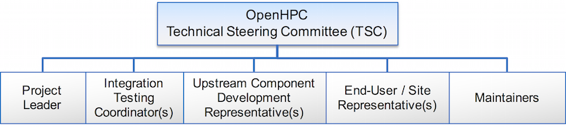

# OpenHPC Governance

As of May 2016, the OpenHPC project is operating as a [Collaborative Project](http://collabprojects.linuxfoundation.org) through the [Linux Foundation](http://www.linuxfoundation.org). Overall OpenHPC governance is led by two primary entities outlined as follows:

1. **Governing Board:** general responsibilities include budgetary approval and the management of all non-technical business and outreach/communication.
2. **Technical Steering Committee (TSC)**: general responsibilities include coordination and management of all technical matters for the project, including release management, component selections, and technical community engagement. The TSC has regular meetings open to the general public. Find meeting details in [TSC-Meetings.md](TSC-Meetings.md). Information on the [TSC selection process](TSC-Election-Process.md) is also available.

The rules establishing the proceedings of the TSC and the Governing Board can be found in the [OpenHPC Project Charter](https://charter.openhpc.community/).

***
The TSC includes a variety of roles intended to help organize the work effort and to include representation from development groups and end users.  A graphical overview of the current roles that comprise the TSC is highlighted below.

***
The current members of the OpenHPC TSC are listed in [TSC.md](TSC.md), which is generated from the machine-readable roster in [tsc.yaml](tsc.yaml). Membership lists of previous terms are kept in the [history](history/) directory.
